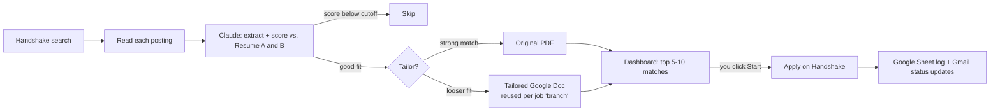

# Offer Ledger, powered by Job Agent

**Offer Ledger** is a local job-search app. Inside it runs **Job Agent**, an AI workflow that searches Handshake for jobs, ranks them against two resumes, tailors a resume for each job (in the same format, without inventing anything), and applies to the jobs you pick with one **Start** click. Every application is logged to Google Sheets.

You use it through a Windows Vista "Aero" style dashboard that runs on your own computer.

> Built with agentic AI: designed and developed with Claude Code, with several AI coding sessions working in parallel (one leading, others on the pipeline, the dashboard, cover letters and the Tailor sub-agent).

## Job Agent's specialists

Job Agent splits the work into six specialists. Each one has a single job:

| Specialist | What it does | How |
|---|---|---|
| **Scout** | Reads each Handshake posting and pulls out the details | One Claude request (low effort) |
| **Matchmaker** | Scores the job against both resumes and the stored tailored copies, and picks the best one | One Claude request (medium effort) |
| **Tailor** | Rewords resume bullets for the job, using only verified facts, so the resume stays one page | **Sub-agent:** a Claude tool-use loop. It drafts edits, checks each one with a `check_edit` tool (fact guardrail, locked lines, real font-metric line fit), rewrites what fails and submits with `submit_plan`. The same checks run again in code afterwards, so it can't bypass them |
| **Scribe** | Writes cover letters, fact-checked against the same sources | **Sub-agent:** a Claude tool-use loop. It drafts the letter, checks every sentence with a `check_letter` tool (no new employers, numbers, tools or titles; trading kept personal; no overstated skills), rewrites what fails and submits with `submit_letter`. The same check runs again in code afterwards and drops anything that still fails |
| **Courier** | Drives the agent's Chrome on Handshake: attaches the resume and submits, at a human pace | Plain code (Playwright) |
| **Clerk** | Reads the Handshake Gmail, updates each application's status and files the emails | Gmail API, plus one Claude request to sort the emails |

The dashboard's **Specialists** page shows what each one did in the last 30 days. **Claude Usage** shows tokens and estimated cost by specialist.

## What it does

- **Matching:** every posting is scored 0-100 against both base resumes *and* the tailored copies already in storage. The agent picks the best one itself and explains why it fits and what's missing.
- **Tailoring is the last resort:** a new tailored copy is made only when even the best stored resume scores under the cutoff. Each job is tagged with a job family (e.g. "Supply chain data analyst") so copies stay organized.
- **Learns from results:** every resume carries its track record (applications sent, interviews or offers from Gmail). Proven copies are compared first, and a better record can decide a near-tie.
- **Tailoring that keeps your format:** the base resume PDFs are never modified.
  - Each resume gets a Google Doc *master*, rebuilt from the PDF's actual fonts, sizes and positions. It's checked against the original line by line (within 1pt).
  - Tailored copies swap in reworded bullets, and the swapped text keeps the styling of the text it replaces.
- **No-fabrication guardrails:** only bullets and coursework may change.
  - An edit can't add an employer, number, tool or skill that isn't in the verified sources: both resumes, the transcript, and confirmed career facts.
  - Every edit must fit in the same number of lines, measured with the real font metrics, so the resume stays one page.
- **One-click Start:** you choose from the ranked list, and the agent applies one by one at a human pace.
  - It stops at a daily limit, and it never gets around CAPTCHAs or bot checks.
  - Anything it can't safely finish is marked "Needs you".
- **Cover letters:** when an application asks for one, the agent writes a short letter for that job and attaches it (Handshake's cover letter slot or the employer's form).
  - It's written only from the resume being sent (an original or a tailored branch copy) and confirmed career facts. Every sentence is fact-checked like the resume edits, so nothing new gets in; trading stays described as personal, and tool skills are never overstated.
  - The **Cover Letters** tab lets you write one yourself: pick the job (or paste a posting), pick the resume it's written from, and optionally prompt it, e.g. with the application's question. The prompt steers focus and tone but is never treated as a fact.
  - Each letter is a Google Doc you can edit; a fresh PDF is exported whenever it's attached.
- **Tracking:** applications go to a Google Sheet, with a link to the exact resume Doc that was sent. Handshake emails update each application's status.

## Engineering highlights

| Area | Details |
|---|---|
| AI | Claude API (structured JSON outputs, adaptive thinking, server-side refusal fallbacks, prompt caching of the resumes across a run, retries for transient errors) |
| Pipeline | Browser reads stay sequential on one Playwright thread; Claude extraction, scoring and tailoring for earlier postings run in a small worker pool (about 2.3x faster in a benchmark with simulated timings), in posting order so branch reuse works the same as a one-at-a-time run |
| Documents | PDF layout analysis with PyMuPDF to Word to Google Docs conversion, a calibration loop against the original, and Docs API edits that keep each run's styling |
| Backend | Python, FastAPI, SQLModel/SQLite (WAL), APScheduler |
| Integrations | Google Sheets, Docs, Drive and Gmail (OAuth), and Handshake through Playwright using the user's own signed-in session |
| Frontend | Vanilla JS + CSS: a Windows Vista Aero theme with a light/dark toggle, keyboard accessible, and a phone layout |
| Observability | Every search and apply run is recorded with its funnel (found, in area, read, queued, skipped). Every Claude call is recorded with its tokens, cache reads and estimated cost, shown per specialist |
| Tests | pytest suite covering layout parsing, fit checks, guardrails, Docs edit requests, branch reuse, the parallel pipeline and batch applying |

## Run it

See [SETUP.md](SETUP.md). In short: add an Anthropic API key and a Google OAuth client, run `start.bat`, upload your resumes, and sign in to Handshake once.

## Privacy

Resumes, transcripts, the database, Google tokens and API keys stay on your computer (`data/`, `.env` and `credentials.json` are never committed). Nothing is submitted without you starting the run.
