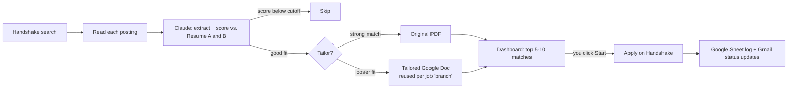

# Job Agent: an agentic AI workflow for the job search

An AI agent that searches Handshake for jobs, ranks them against two resumes, tailors a resume for each job (in the same format, without inventing anything), and applies to the jobs you pick with one **Start** click. Each application is logged to Google Sheets.

It runs locally behind a Windows Vista "Aero" style dashboard.

> Built with agentic AI: designed and developed with Claude Code, with several AI agents working in parallel (one leading, one optimizing the pipeline, one polishing the dashboard).

## What it does

- **Matching:** every posting is scored 0-100 against both base resumes *and* the tailored copies already in storage. The agent picks the best one itself and explains why it fits and what's missing.
- **Tailoring is the last resort:** a new tailored copy is made only when even the best stored resume scores under the cutoff. Each job is tagged with a job family (e.g. "Supply chain data analyst") so copies stay organized.
- **Learns from results:** every resume carries its track record (applications sent, interviews or offers from Gmail). Proven copies are compared first, and a better record can decide a near-tie.
- **Tailoring that keeps your format:** the base resume PDFs are never modified.
  - Each resume gets a Google Doc *master*, rebuilt from the PDF's actual fonts, sizes and positions. It's checked against the original line by line (within 1pt).
  - Tailored copies swap in reworded bullets, and the swapped text keeps the styling of the text it replaces.
- **No-fabrication guardrails:** only bullets and coursework may change.
  - An edit can't add an employer, number, tool or skill that isn't in the verified sources: both resumes, the transcript, and confirmed career facts.
  - Every edit must fit in the same number of lines, measured with the real font metrics, so the resume stays one page.
- **One-click Start:** you choose from the ranked list, and the agent applies one by one at a human pace.
  - It stops at a daily limit, and it never gets around CAPTCHAs or bot checks.
  - Anything it can't safely finish is marked "Needs you".
- **Tracking:** applications go to a Google Sheet, with a link to the exact resume Doc that was sent. Handshake emails update each application's status.

## Engineering highlights

| Area | Details |
|---|---|
| AI | Claude API (structured JSON outputs, adaptive thinking, server-side refusal fallbacks, prompt caching of the resumes across a run, retries for transient errors) |
| Pipeline | Browser reads stay sequential on one Playwright thread; Claude extraction, scoring and tailoring for earlier postings run in a small worker pool (about 2.3x faster in a benchmark with simulated timings), in posting order so branch reuse works the same as a one-at-a-time run |
| Documents | PDF layout analysis with PyMuPDF to Word to Google Docs conversion, a calibration loop against the original, and Docs API edits that keep each run's styling |
| Backend | Python, FastAPI, SQLModel/SQLite (WAL), APScheduler |
| Integrations | Google Sheets, Docs, Drive and Gmail (OAuth), and Handshake through Playwright using the user's own signed-in session |
| Frontend | Vanilla JS + CSS: a Windows Vista Aero theme with a light/dark toggle, keyboard accessible, and a phone layout |
| Tests | pytest suite covering layout parsing, fit checks, guardrails, Docs edit requests, branch reuse, the parallel pipeline and batch applying |

## Run it

See [SETUP.md](SETUP.md). In short: add an Anthropic API key and a Google OAuth client, run `start.bat`, upload your resumes, and sign in to Handshake once.

## Privacy

Resumes, transcripts, the database, Google tokens and API keys stay on your computer (`data/`, `.env` and `credentials.json` are never committed). Nothing is submitted without you starting the run.
